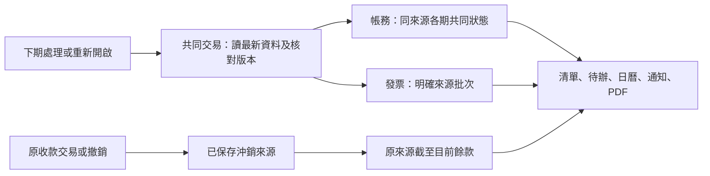

# VAT 2.18 跨期關聯

研究與實作範圍為同一業務來源的延續。沿用 v2.17 的介面元件，不另換全域風格。

| 類別 | 識別 | 共同進度 | 保留的期別資料 |
| --- | --- | --- | --- |
| 欠缺文件／待歸 | clientId＋field＋sourcePeriodId＋lineageRootId | status、completedAt、共享 revision／actor、提醒完成 | 本期名稱、備註、taskPlan、排除紀錄 |
| 款項 | 保存 allocation 的 itemKey、sourcePCId、sourcePeriodId | 截至目前的來源餘款與後期沖抵 | 本期收款、FIFO 快照、原期末餘款及原應收 |
| 跨期發票 | source PC ID＋較後期 handler PC ID | 每批完成、重開、處理期及版本 | 原始 carryInvoiceForward 旗標及收件／稅款事實 |

## 查核發現與處理

原帳務延續函式明確複製獨立紀錄，但已有 sourcePeriodId／lineageRootId 可追溯；共同狀態以複合身份同步，沒有按名稱合併。款項引擎已有跨期沖銷，舊讀取只顯示各期快照，因此另設最新進度讀模型，不替換財務寫入依賴的 ledger。發票的前後期雙布林缺少來源固定，新增來源 resolution 與 consumer pin；補建期別不改綁。

手動待辦、一般日曆記事本身為全域單筆 ID；帳務與收件日曆是來源投影。每期稅額、稅款繳納、其他應繳、留底參考、銷貨收入、共用備註及整期結案是各期事實，不能按同名或同額視為同一延續事項。

## 交易契約

`proposedRows` 是原操作套用後的完整 PC 集合。核心不復活已刪除的整筆 PC，不把副本刪除當成事項完成。`baselineRows` 來自獨立 DB 基準，不依賴可能已被舊 UI 原地修改的 state。

共同 adapter 在同一 IndexedDB 交易讀最新 periodClients／periods、計畫聯動、寫入原操作及所有 changed IDs。原生合併付款也補寫原收款公司迴圈以外的 planned rows；只衍生進度的資料不重跑其他公司的財務 ledger。第 2 筆 put 故障時整筆回復。

`edit` 表示明確使用者意圖；`seed` 只作有證據的既有狀態收斂；`resolve` 為使用者核對舊分歧。同版本互相矛盾、重複來源及來源缺席保持可見問題。載入／核對期間主工作區暫停操作，最後才顯示一致狀態。

## 來源檔與驗證

- [帳務核心](../vat/accounting-links-core.js)、[帳務介面](../vat/accounting-links-ui.js)。
- [款項讀模型](../vat/payment-links.js)、[發票核心與介面](../vat/invoice-links.js)。
- [共同交易](../vat/cross-period-transactions.js)、[備份關聯圖](../vat/cross-period-backup.js)。
- 純測試、真 IndexedDB、兩個視窗、鎖定來源、刪除／重開、關聯備份及真列印 DOM 的結果，集中記錄於 [TEST_REPORT.md](../TEST_REPORT.md)。

五個子代理分別負責帳務核心、款項、發票盤點與開發、帳務介面、獨立對抗驗證；主代理整合共同交易、備份、整套回歸及發布。測試與截圖只用合成資料。
